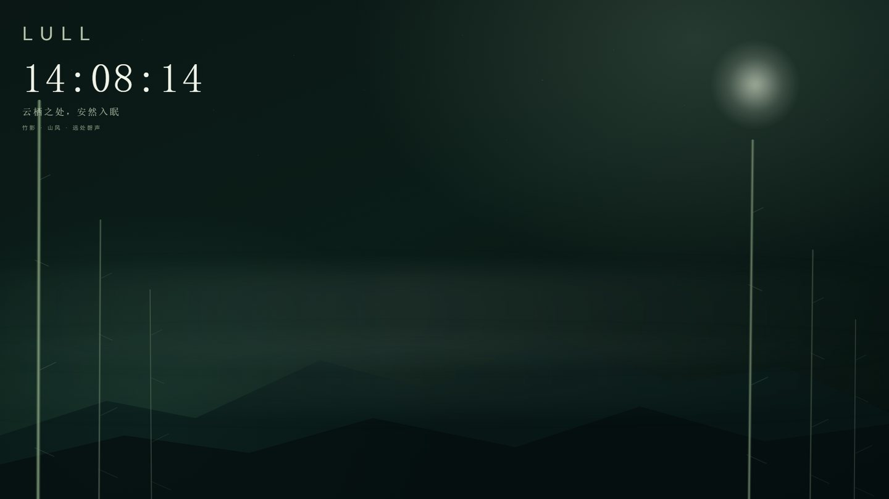
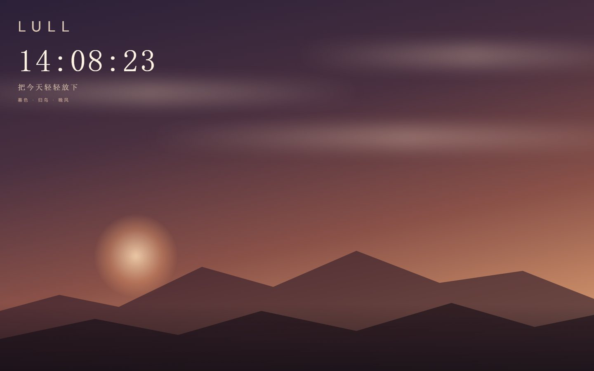
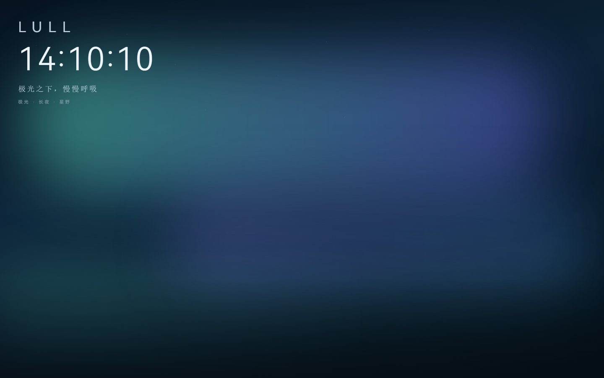
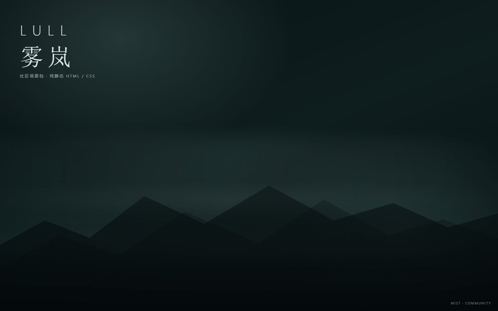
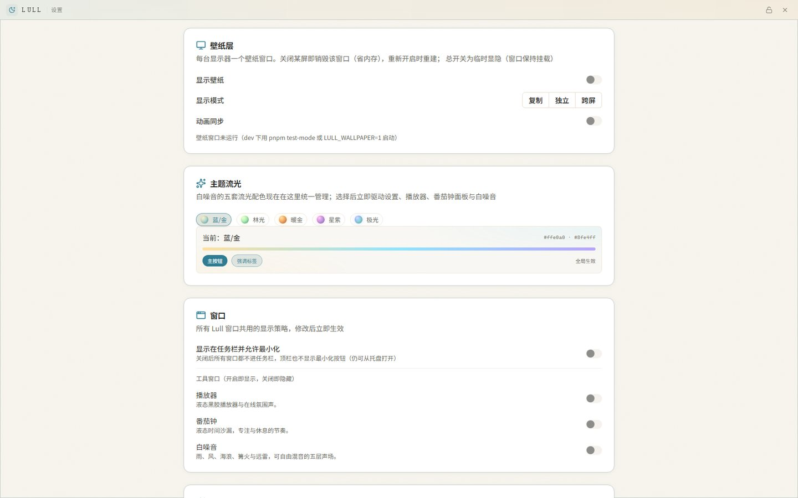

# 云栖 / Lull

> 云栖之处，安然入眠。

**Lull** 是一个开源的 Windows 桌面应用，做两件事：把动态场景铺在桌面上，把白噪音放到耳边。没有推送，没有提醒，你睡着或者忙完的时候它也不会跳出来说什么。

`Windows 10 / 11` · `Tauri + Win32` · `GPL-3.0-or-later` · `v0.1.x`

[官网](https://lull-desktop.github.io/Lull/) · [安装](#安装) · [使用指南](#使用指南) · [设计理念](#设计理念) · [开发者指南](#开发者指南) · [许可证](#许可证与归属)

> **怎么读这份文档**：想用，去[开始使用](#开始使用)；想知道它为什么这么设计，看[设计理念](#设计理念)；要改代码、做场景或写插件，直接跳到[开发者指南](#开发者指南)。

***

## 这是什么

壁纸和声音在多数助眠应用里是分开的两个功能，Lull 把它们放在一起：桌面在动，耳机里有雨。开机后它待在托盘里，不占前台，也不弹通知，想用的时候点一下。

适合睡前想放松、夜里需要稳定背景音、长时间专注又不想被播放器打断的人。如果你要在线歌单、账号体系、跨设备同步，或者用的是 macOS / Linux，那它帮不上忙，原因写在[当前边界](#当前边界)。它不推送内容，不催你打卡，也不收集使用数据；断网之后壁纸、声景和番茄钟照常工作。

壁纸挂在系统桌面层（Win32 `WorkerW` / `Progman`）的图标底下，是真的桌面背景，不是一个盖上去的全屏窗口，所以桌面图标照样能点能拖。代码分 Core / Extensions / Community / Services 四层，见[架构一页](#架构一页)。

## 界面预览

| 竹影（默认）                              | 暮色                                |
| ----------------------------------- | --------------------------------- |
|  |  |

| 极光                                  | 社区示例「雾岚」                          |
| ----------------------------------- | --------------------------------- |
|  |  |



## 功能

下面按用途分了四组，具体怎么操作在[使用指南](#使用指南)。

### 桌面壁纸

目前有三个官方场景：竹影（默认）、暮色、极光，动画都走慢节奏、低干扰的路子。每台显示器各开一个壁纸窗口，互不影响。展开方式有复制、独立、跨屏三种，跨屏时可以让动画相位对齐（见[壁纸与多屏](#壁纸与多屏)）。设置里改场景参数是实时生效的，不用重启。

### 声景与专注

白噪音分五层：雨、雷、风、海浪、篝火，每层单独调音量，另有一个主音量、静音和睡眠定时器。番茄钟做成液态沙漏，专注 / 短休 / 长休三段轮换，偏好会存下来。播放器是液态黑胶浮窗，在线氛围声和本地曲目共用同一套控制。

### 常驻与窗口

点关闭只是把窗口藏起来，进程还在，要退得走托盘里的「退出」。所有工具都是无边框浮窗，叫得出来也收得回去。设置只有一个窗口，里面分偏好、壁纸、扩展三个页签（见[设置](#设置偏好壁纸与扩展)）。

### 可扩展

第三方场景包和工具插件都能装。安装动作只把文件落盘，直到你点启用才授予它声明过的能力，导入前会先给你看清单、能力和体积。想做扩展的话，两个 TypeScript SDK、示例包和打包工具都在本仓库里，见[做扩展](#做扩展)。

> 完整功能和版本动态以[官网](https://lull-desktop.github.io/Lull/)为准。

## 开始使用

### 安装

| 渠道                                                               | 说明               |
| ---------------------------------------------------------------- | ---------------- |
| [官网](https://lull-desktop.github.io/Lull/)                       | 推荐的下载入口，附版本说明    |
| [GitHub Releases](https://github.com/Lull-Desktop/Lull/releases) | 历史安装包与更新日志       |
| [从源码构建](#本地开发与打包)                                                | 想改代码，或者暂时没有可用安装包 |

系统要求 Windows 10 / 11（x64）。Lull 依赖 Win32 桌面层，没有跨平台回退方案。

> 安装包目前没做代码签名，Windows 可能会提示「未知发布者」。介意的话可以从源码自己构建，签名和素材授权的进度写在[当前边界](#当前边界)里。

### 第一次启动

1. 壁纸自动铺满所有显示器，托盘出现 Lull 图标。
2. 左键点托盘图标打开设置，在「壁纸」页选场景、调参数、设多屏模式。
3. 托盘菜单里可以直接打开播放器、番茄钟和白噪音。

## 使用指南

这一节讲怎么用。只想知道它有哪些功能，上面那段就够了。

### 托盘与窗口

托盘是唯一的常驻入口，左键点它显示或隐藏设置，右键出菜单。

| 菜单项             | 作用                          |
| --------------- | --------------------------- |
| 显示/隐藏设置         | 切换设置窗口，不结束进程                |
| 播放器 / 番茄钟 / 白噪音 | 打开对应浮窗                      |
| 扩展              | 只列出已启用的工具扩展，点击即打开；没有启用项时不显示 |
| 退出              | 结束进程，壁纸同时卸下并还原桌面            |

关任何窗口都只是隐藏。壁纸窗口不进任务栏，也不参与窗口相关的偏好设置，它只管桌面那一层。

### 设置：偏好、壁纸与扩展

| 页签     | 你能做的事                                                    |
| ------ | -------------------------------------------------------- |
| **偏好** | 界面语言（跟随系统 / 简体中文 / English）、主题流光配色、窗口行为（任务栏与最小化）、关于与扩展入口 |
| **壁纸** | 选场景、切多屏模式、开关同步、调整场景参数（带范围的参数以滑条呈现）                       |
| **扩展** | 查看已装内容与工具，启用 / 停用、打开、卸载，以及从文件安装新内容                       |

### 壁纸与多屏

| 模式     | 效果                      |
| ------ | ----------------------- |
| **复制** | 所有显示器同一画面；可开关同步         |
| **独立** | 每台显示器各自设置，互不影响          |
| **跨屏** | 一张画布横跨全部显示器，画面连续；同步固定开启 |

同步做的是让动画相位按绝对时间对齐，这样几块屏拼起来是一整幅画，而不是几块各晃各的屏保。跨屏模式按物理像素的桌面坐标计算画布，副屏在左边、坐标为负的情况也算得对。

### 声景、专注与播放

白噪音挂一整夜的话，记得把睡眠定时器打开，到点它会自己静音。五层音量互相独立，怎么配没有标准答案，拧到自己舒服就行。

番茄钟按专注 / 短休 / 长休轮换，三段时长这类偏好会记下来，下次打开还是那套节奏。播放器的在线氛围声和本地曲目共用一套控制，切来源不用换窗口。

### 安装与管理扩展

1. 打开 **设置 → 扩展**。
2. 选择 **从文件安装**，挑一个 zip，也可以直接把文件拖进窗口。
3. 导入前会先显示清单摘要：名称、版本、能力与体积。
4. 安装只落盘，不执行任何代码；点启用时才授予它声明过的能力。
5. 启用之后就能在「扩展」页或者托盘里打开。

另外有几条规则：

- 同 id 的场景会覆盖更新，壁纸按新版本重新加载，不用手动删旧包。
- 卸载是两段式，第一次点「卸载」，5 秒内再点一次才确认。
- 开发模式可以挂载本地目录做热调试，面向扩展作者。

### 配置与日志

| 内容        | 位置                                                                  |
| --------- | ------------------------------------------------------------------- |
| 配置（窗口与壁纸） | `%APPDATA%\app.lull.desktop\display.json`（旧版 `wallpaper.json` 不再读取） |
| 应用日志      | `%TEMP%\lull\app.log`                                               |
| 原生宿主日志    | `%TEMP%\lull_wallpaper.log`                                         |
| 验收截图与日志   | `%TEMP%\lull\`                                                      |

出问题的话，带上对应日志去 [GitHub Issues](https://github.com/Lull-Desktop/Lull/issues) 说一声。如果是壁纸没铺上或者层序乱了，顺便写一下显示器有几台、怎么摆的。

## 设计理念

Lull 的取舍不多，但每条都很清楚。下面几点解释了它为什么长成现在这样。

### 不打扰

没有推送，没有新手引导，也没有打卡压力。工具都是需要时点开、不用时消失的浮窗，关掉不等于退出；壁纸安静地待在图标底下，不抢焦点。

### 桌面即画布

壁纸挂在桌面层的图标之下，不是全屏置顶的窗口。为了这个效果，Lull 走的是 Tauri + Win32 这条更难的路线：每台显示器一个独立窗口，跨屏时共用一套画布坐标，动画相位按绝对时间对齐。代价是只支持 Windows，好处是桌面确实变成了壁纸。

### 本地优先

不用账号，不联网也能跑。在线服务、云同步、内容市场都不是使用前提；在线氛围声只是可选项，断网了壁纸、声景和番茄钟照旧。数据只写在本机的配置和日志目录里，不上传。

### 谨慎地开放

四层结构（Core / Extensions / Community / Services）决定了开放的顺序：Core 和内置场景完整开源，扩展接口先公开，兼容承诺放在后面。公开不等于承诺兼容——接口在 Experimental 阶段还会调整，跑通了才逐条升到 Beta / Stable，同时补上版本规则和迁移说明（见[扩展接口的成熟度](#扩展接口的成熟度)）。

许可也是分层的：应用代码 GPL-3.0-or-later，SDK 接口 Apache-2.0，内容与文档 CC BY 4.0。

## 开发者指南

这一节写给想改代码、做场景或写插件的人，只想使用 Lull 的话可以跳过。

### 架构一页

| 层               | 当前落地                                                                                                               | 说明                                                                                                |
| --------------- | ------------------------------------------------------------------------------------------------------------------ | ------------------------------------------------------------------------------------------------- |
| **Core**        | `src-tauri/src/{wallpaper,window_host,config}` + `src/core`                                                        | 桌面宿主、显示器拓扑、窗口生命周期、配置、IPC、原生桥                                                                      |
|  **Extensions** | `src/sdk/{scene,widget,content}` + `src/scenes` + `src/widgets` + `packages/{widget-sdk,scene-sdk}`                | 场景清单/目录协议、脚本场景桥、工具窗口能力分层；两个 SDK 均为 TypeScript（`dist` + `.d.ts`）；外部场景支持静态包与 `wallpaper.script` 沙箱包 |
| **Community**   | `content/schema` + `public/content` + `scripts/{hash,sign,validate}-content.mjs` + `src-tauri/src/content_package` | 内容包格式、包摘要、目录签名、校验工具；本地安装器（拖入 zip / 文件夹、摘要复核）已落地；仍无在线市场                                            |
| **Services**    | 设计文档                                                                                                               | 内容索引、同步、发布服务；不影响本地核心运行                                                                            |

壁纸的运行协议是这样的：Rust 把 `mode / sync / scene / canvas / view / params` 编码进窗口 URL 哈希，前端 `SceneHost` 按 Manifest 解析默认值、能力与兼容性，再决定用内置组件还是外部包；脚本场景由 `scene-bridge` 把帧推给 `@lull/scene-sdk`。这条协议是前后端之间唯一的画面契约。

模块边界、依赖规则和更细的模块图见[架构说明](docs/architecture.md)。

### 扩展接口的成熟度

第二层（Extensions）现在已经公开：源码、清单格式、两个 SDK 包、示例和打包工具都在本仓库里，可以直接阅读、开发、分发。但场景接口和工具接口目前都处在 Experimental 阶段，我们会继续调整接口形态，升级时不保证向后兼容。

所谓「验证后再开放」，不是先把代码藏起来、以后再一次性放出，而是推迟对尚未验证的接口作出长期兼容承诺：先让 Core 稳定运行，跑通一条就升一条。

| 阶段                   | 兼容性承诺                      |
| -------------------- | -------------------------- |
| **Experimental** 实验性 | 接口可能调整；升级时可能需要修改扩展         |
| **Beta** 测试版         | 尽量保持兼容；重大变化提前说明            |
| **Stable** 稳定版       | 按明确的版本规则维护兼容性，并提供弃用周期与迁移说明 |

三个阶段都在同一个开源仓库里，区别只在承诺的强度，不在代码看不看得见。

| SDK                    | 版本      | 阶段           | 已知可能变动的部分                                    |
| ---------------------- | ------- | ------------ | -------------------------------------------- |
| `@lull/scene-sdk`（场景）  | `0.1.0` | Experimental | 帧字段增删、参数类型细化、显示模式与跨屏画布的声明方式、`hostApi` 升级规则   |
| `@lull/widget-sdk`（工具） | `0.2.0` | Experimental | 能力粒度拆分（尤其音频 / 媒体边界）、桥方法参数、主题 token 命名、窗口布局字段 |

两条路线的技术边界不一样，所以各自独立定级、独立演进：Scene SDK 负责背景怎么展示，Widget SDK 负责桌面工具怎么运行，一个进 Beta 不代表另一个也进。

可以依赖、但实验期内会变的部分，包括 `packages/*-sdk` 导出的类型与函数（含 `./react`、`./vue`、`./testing` 子入口）、`src/sdk/**` 的清单与运行时契约、Scene / Widget Manifest 的字段与 `schemaVersion` 及能力名称、iframe 与宿主之间的 postMessage 桥协议及授权语义，以及内容包目录结构、`integrity` 整包摘要与安装 / 加载规则。

读得到但不算接口承诺的部分，包括 `src-tauri/**`、`src/core/**`、`src/components/**` 等未导出模块，内置场景与工具的实现细节（可读可改，fork 之后要自己跟进上游），以及实验期内新增、还没写进文档的行为。

距离 Stable 还差什么，看这张表（「部分 / 待补」就是差距）：

| 验证项                   | Scene SDK                      | Widget SDK              |
| --------------------- | ------------------------------ | ----------------------- |
| 不改 Core 就能做出新场景 / 新工具 | 已具备                            | 已具备                     |
| 能从本地内容包安装并运行          | 已具备（zip / 拖入）                  | 已具备（`.lull-widget.zip`） |
| 能读参数，并在重启后保留应持久化的设置   | 部分（参数经 URL 哈希热更，持久化由包自理）       | 部分（宿主 KV 可用，参数模型未统一）    |
| 能声明支持的显示模式并正确处理画布与视口  | 部分（能力位已表达，声明粒度未固化）             | 不适用                     |
| 有明确的版本、兼容与不兼容升级规则     | 待补（`hostApi` 已有，弃用与迁移未建立）      | 待补（有兼容矩阵，无弃用策略）         |
| 权限清晰，第三方内容不能越权调用原生能力  | 已具备（iframe 沙箱 + 只读 capability） | 部分（逐项授权，音频与系统能力仍在收敛）    |

推进顺序上，先把 Core 与内置场景保持全开源，再挑一个内置场景，把描述、参数和入口从运行时里拆出来；然后用 `examples/` 做一个不改核心就能导入运行的独立示例包，把验证通过的部分固化成实验性 SDK，补齐 Manifest 规范与开发文档；最后逐条发布 Beta / Stable，并写上版本规则和迁移说明。

在这之前，请把 `@lull/*-sdk` 和相关清单字段当作 **0.x 实验性接口**：可以用，可以分发内容包，但升级 Lull 时请预留改动成本。

### 目录结构

```text
src/
  app/                     # Next.js 路由外壳（设置 / 壁纸 / 工具窗）
  core/
    wallpaper/params.ts    # URL 哈希协议、跨屏几何、同步相位（纯函数）
    window/                # 无边框窗口的 IPC 封装与贴合计算
  content/catalog.ts       # 内容目录加载服务（依赖 sdk/scene）
  sdk/
    scene/                 # Scene Manifest、Catalog、运行时类型
    widget/                # Widget Manifest、能力分层
    content/               # 通用内容包清单
  scenes/                  # 官方内置场景（bamboo / aurora / dusk）、外部场景桥与注册表
  widgets/registry.ts      # 内置工具窗口元数据（设置页唯一来源）
  components/              # 窗口外壳、共享 UI、播放器/番茄钟/白噪音实现
  styles/                  # Tailwind 主题与壁纸动效
packages/widget-sdk/       # 第三方插件侧 SDK：TypeScript 源码 → dist + .d.ts
packages/scene-sdk/        # 场景侧 SDK：参数/几何/同步/可见性桥
examples/widgets/          # 原生 / React / Vue 三个 TypeScript 插件包示例
examples/scenes/           # 可安装内容包示例（静态 / 脚本场景）
src-tauri/
  src/
    lib.rs                 # 只做插件/命令/生命周期接线
    config/                # display.json 模型、版本迁移、原子写盘
    wallpaper/
      ffi.rs               # lull_native.dll 加载与 C ABI
      topology.rs          # 显示器枚举、虚拟桌面几何
      protocol.rs          # 壁纸 URL 哈希协议
      windows.rs           # 壁纸窗口创建/销毁/重建/热更新
      watchdog.rs          # 挂载修复、拓扑指纹、WorkerW 补建
      runtime.rs           # 配置状态、生命周期、IPC 命令
    window_host/           # 窗口工厂 + WidgetSpec + 全局窗口偏好
  content_package/         # 用户内容包：清单校验、整包摘要、zip 安装、lullcontent:// 协议
  native/                  # C++ 原生宿主（lull_native.dll）
  acceptance/              # Windows 真机验收工具（Python）
  capabilities/            # Tauri 权限（壁纸窗口刻意不在授权列表内）
public/content/            # 随包分发的内容目录与外部场景示例
content/schema/            # JSON Schema
docs/                      # 架构、SDK、Skill、内容格式、原生宿主、贡献指南
website/                   # Astro 官网（独立 pnpm 项目，CI 发布到 GitHub Pages）
scripts/                   # 构建、内容校验、预览、验收编排
```

### 本地开发与打包

前置条件：

| 依赖            | 版本 / 说明                                                              |
| ------------- | -------------------------------------------------------------------- |
| Windows       | 10 / 11（原生宿主只针对 Win32 桌面层）                                           |
| Node.js       | 24（见 `.node-version`）                                                |
| pnpm          | 11（见 `package.json` 的 `packageManager`）                              |
| Rust          | `stable-x86_64-pc-windows-msvc`（由 `rust-toolchain.toml` 固定）          |
| Visual Studio | 「使用 C++ 的桌面开发」+ Windows 10/11 SDK                                    |
| Git Bash      | 编译 `lull_native.dll` 需要 `bash` / `cygpath`                           |
| Python / uv   | `pnpm test-mode` 需要 Pillow；本机缺 Pillow 时脚本会自动用 `uv run --with pillow` |

```powershell
pnpm install

# 编译原生宿主（首次或改过 src-tauri/native 后）
& "C:\Program Files\Git\bin\bash.exe" src-tauri/native/build-shim.sh

pnpm dev
```

`pnpm dev` 默认不接管桌面壁纸（debug 构建），只打开设置窗口，方便调 UI。想在开发态验证真实壁纸挂载，用一键验收模式：

```powershell
pnpm test-mode            # 构建 DLL → 启动 → 层序/命中/动画验收 → 退出并还原桌面
pnpm test-mode -SkipVerify -HoldSeconds 30
```

> 验收脚本需要 Pillow。本机 Python 没装的话，只要 PATH 里有 `uv` 就会自动准备临时环境；也可以用 `LULL_PYTHON` 指定一个装了 Pillow 的解释器。

打包：

```powershell
pnpm build
```

`scripts/prebuild.mjs` 会依次做这些事：校验内容目录 → 编译 `lull_native.dll` → 清理 `dist/.next` → Next 静态导出 → 触碰 `lib.rs` 强制重嵌入。

产物整理（msi / exe / 便携版 zip + 校验和）：

```powershell
pnpm release:package      # → artifacts/release/
```

### 自定义扩展的方式

#### 使用 Skill（Beta）开发组件和场景

[`Skill/lull-extension`](Skill/lull-extension) ：是一份用于开发组件和场景的技能包，帮助你使用AI智能体完成自定义拓展开发。

```bash
npx skills add Lull-Desktop/Lull --skill lull-extension -y   # 装进代理；或直接 node Skill/lull-extension/bin/lull-ext.mjs

lull-ext sdk build --from .                                  # 编译当前代码对应的 @lull/*-sdk
lull-ext new widget ./my-tool --id my-tool --name "我的工具"    # 生成骨架 + vendor
lull-ext validate ./my-tool --strict                         # 按宿主规则离线校验
lull-ext pack ./my-tool --out ./artifacts                    # 产出可安装 zip
```
详见[`Skill/lull-extension/README.md`](Skill/lull-extension/README.md)。

#### 新建自定义场景包

静态包只要一个 `catalog.json` 加一个 HTML 入口：

```text
my-scene/
  catalog.json
  scenes/mist/
    index.html
```

在 `catalog.json` 里登记 manifest（`id`、`version`、`license`、`entry`、`capabilities`，可选 `performance`、`compatibility`），然后：

```powershell
pnpm content:hash --bundle ./my-scene
pnpm content:hash --bundle ./my-scene --check
pnpm content:pack ./my-scene --out artifacts
```

静态包跑在 `sandbox=""` 的 iframe 里，不执行 JavaScript，没有 Tauri IPC 和同源存储权限，也不能声明参数或同步，动态效果只能用 CSS 做。

> 别用 Windows 自带的 `Compress-Archive` 或某些压缩工具，它们可能把 zip 条目写成反斜杠路径，Lull 安装器会按安全规则拒掉。`content:pack` 统一写正斜杠和 UTF-8。

需要参数、几何或同步的场景，声明 `wallpaper.params`、`wallpaper.sync` 和 `wallpaper.script`，并把 `@lull/scene-sdk` 打进包内：

```powershell
pnpm scenes:sdk
# 在场景工程里用 esbuild / Vite 把 main.ts 打成包内 main.js
```

设置页会按 Manifest 的 `params` 自动渲染控件，改值后热更壁纸 URL 哈希，再由 `scene.onFrame((frame) => ...)` 把 `frame.params` 送到场景，不用重启壁纸。可以直接安装的示例有两个：[`examples/scenes/param-demo`](examples/scenes/param-demo)（参数演示）和 [`examples/scenes/three-scene`](examples/scenes/three-scene)（Three.js WebGL）。

#### 自定义Widget插件

静态包安装到用户目录，宿主壳 + iframe + Rust 状态 KV，支持自绘窗口顶栏和透明背景，提供原生 / React / Vue 三个示例。包格式、能力声明与 SDK 接入见 [Widget SDK](docs/widget-sdk.md)，示例在 [`examples/widgets`](examples/widgets)。

> **安全边界**：静态场景不执行脚本；脚本场景跑在 opaque-origin 的 `allow-scripts` iframe 里，只能通过 Scene SDK 桥读取宿主下发的帧，拿不到宿主 DOM、任意 Tauri IPC、Rust 命令或 Win32 调用。插件窗口同理，只拿到自身状态命令和窗口操作。

### 常用命令

开发、构建与测试：

| 命令                       | 作用                                         |
| ------------------------ | ------------------------------------------ |
| `pnpm dev`               | Tauri 开发模式（debug 默认不启用壁纸）                  |
| `pnpm test`              | Vitest 前端测试（jsdom）                         |
| `cargo test`             | Rust 单元测试（在 `src-tauri/` 下）                |
| `pnpm lint` / `pnpm fix` | Biome 检查 / 自动修复                            |
| `pnpm typecheck`         | 全仓 TypeScript 检查                           |
| `pnpm check`             | lint + typecheck + test + 内容/清单/SDK 校验一次跑完 |
| `pnpm test-mode`         | Windows 真机壁纸验收（构建 DLL、层序/命中/动画）            |
| `pnpm build:next`        | 仅导出 Next 静态前端                              |
| `pnpm build`             | 完整 Tauri 安装包构建                             |
| `pnpm release:package`   | 整理 msi / exe / 便携版 zip 与 SHA256 到 `artifacts/release` |

内容包、SDK 与示例：

| 命令                                                         | 作用                                                   |
| ---------------------------------------------------------- | ---------------------------------------------------- |
| `pnpm content:check`                                       | 校验内容目录、包摘要与目录签名                                      |
| `pnpm content:hash`                                        | 重算并写回内容包的 `integrity` 摘要（`--bundle <dir>` 处理待分发内容包）  |
| `pnpm content:pack <dir>`                                  | 把内容包打成可安装 zip（正斜杠 + UTF-8）                           |
| `pnpm content:sign` / `pnpm content:keygen`                | 用本机私钥给 `catalog.json` 签名 / 生成签名密钥（私钥在 `.keys/`，不进仓库） |
| `pnpm widgets:sdk` / `pnpm widgets:sdk:check`              | 构建插件侧 SDK / 只做类型检查                                   |
| `pnpm scenes:sdk` / `pnpm scenes:sdk:check`                | 构建场景侧 SDK / 只做类型检查                                   |
| `pnpm scenes:samples:{build,hash,check,pack}`              | 构建、重算摘要、校验、打包两个脚本场景示例                                |
| `pnpm widgets:samples:build` / `pnpm widgets:samples:pack` | 构建三个示例插件包 / 打成 `artifacts/*.lull-widget.zip`         |
| `pnpm widget:pack <dir>`                                   | 把任意构建后的 Widget 目录打成可安装 zip                           |

### 文档

| 主题      | 文档                                                                                     |
| ------- | -------------------------------------------------------------------------------------- |
| 架构与模块边界 | [docs/architecture.md](docs/architecture.md)                                           |
| 场景开发    | [Scene SDK](docs/scene-sdk.md) · [`@lull/scene-sdk`](packages/scene-sdk/README.md)     |
| 插件开发    | [Widget SDK](docs/widget-sdk.md) · [`@lull/widget-sdk`](packages/widget-sdk/README.md) |
| Skill  | [docs/extension-skill.md](docs/extension-skill.md) · [`Skill/lull-extension`](Skill/lull-extension/README.md) |
| 内容包格式   | [docs/content-format.md](docs/content-format.md)                                       |
| 扩展中心    | [设计](docs/extension-center.md) · [实施计划](docs/extension-center-plan.md)                 |
| 原生桌面宿主  | [docs/native-host.md](docs/native-host.md)                                             |
| 多语言方案   | [docs/i18n-plan.md](docs/i18n-plan.md)                                                 |
| 参与贡献    | [docs/contributing.md](docs/contributing.md)                                           |
| 许可与合规   | [docs/licensing.md](docs/licensing.md)                                                 |
| 官网与自动发布 | [website/README.md](website/README.md)                                                 |

## 当前边界

下面这些都是有意为之的边界，不是待修的 bug：

- 只支持 Windows。
- 安装是本地行为。只接受单场景包，包必须声明整包摘要，同 id 覆盖也算本地手动更新；社区包内 `.lull-signature.json` 的发布者验签已落地（默认只警告，`invalid`/`mismatch`/`revoked` 阻断），在线更新和回滚还没做。
- 扩展不是通用插件系统。静态包不执行脚本，脚本包只能通过 Scene SDK 桥读帧，两者都拿不到宿主 DOM、原生调用和 IPC。
- 接口还在 0.x。`@lull/widget-sdk`（`0.2.0`）和 `@lull/scene-sdk`（`0.1.0`）随仓库构建，还没发到 npm，不承诺跨版本兼容，见[扩展接口的成熟度](#扩展接口的成熟度)。
- 发布流程还没完备。安装包还没做代码签名，公开分发前要补签名和素材授权复核。

## 许可证与归属

Lull 的许可是分层的，不是一个许可证管全部：

| 范围                                                                  | 许可                                    |
| ------------------------------------------------------------------- | ------------------------------------- |
| 应用代码（Rust / C++ / Next.js / React / 脚本）                             | **GPL-3.0-or-later**                  |
| Scene / Widget / Content SDK 公开接口（`src/sdk/**`、`packages/*-sdk/**`） | **Apache-2.0**                        |
| 官方内容目录、Schema、外部示例                                                  | **CC BY 4.0**                         |
| 文档                                                                  | **CC BY 4.0**                         |
| 字体（Noto Sans SC / Source Han Serif SC）                              | **SIL OFL 1.1**                       |
| Lull 名称与 Logo                                                       | 商标政策，见 [`TRADEMARK.md`](TRADEMARK.md) |

完整 GPL 文本见 [LICENSE](LICENSE)，许可见解与合规说明见 [docs/licensing.md](docs/licensing.md)、[SDK-LICENSE.md](SDK-LICENSE.md) 与 [CONTENT-LICENSE.md](CONTENT-LICENSE.md)。

> **源码提供**：发布安装包时请同时提供同一 release tag 的源码归档；本仓库即对应源码。安装包内包含 `LICENSE`、`NOTICE`、`LICENSES/` 与 `THIRD_PARTY_NOTICES.md`。

