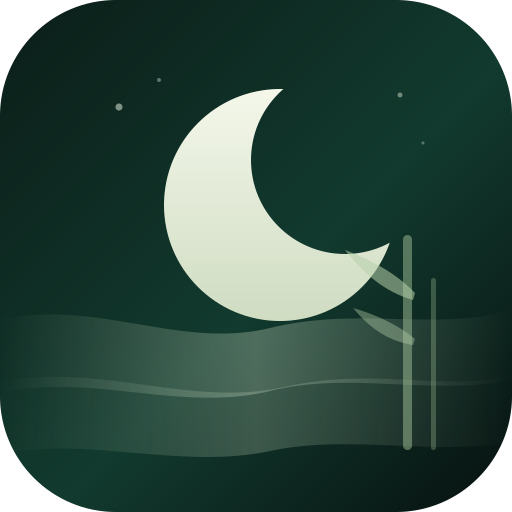
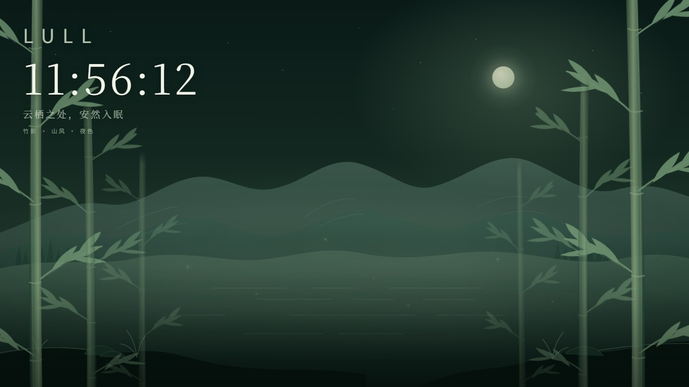

<p align="center">
  
</p>

# Lull · 云栖

**A calmer Windows desktop, with live wallpapers, local music, and ambient sound — open for you to extend.**

[](#install)
[](https://github.com/Lull-Desktop/Lull/releases/latest)
[](LICENSE)

**English** · [简体中文](README.zh-CN.md)

[Download](https://github.com/Lull-Desktop/Lull/releases/latest) · [Website (中文)](https://lull-desktop.github.io/Lull/) · [Developer quickstart](docs/en/getting-started.md) · [Contribute](#contribute)

Lull brings animated scenes beneath your desktop icons, your music library into a floating player, and layered ambient sound into your workspace. It runs locally, lives in the system tray, and supports both English and Simplified Chinese.

For developers, the same desktop is a place to build: create a wallpaper with web technologies, make a tool window, replace the player, or render a small game across your monitors.

## Preview



*Bamboo, a bundled official scene. This repository preview illustrates its visual style; the scene continues to evolve.*

## What you can do

| Capability | What it offers |
| --- | --- |
| **Live wallpapers** | Image and video backgrounds, bundled scenes, and custom web scenes beneath desktop icons. Mirror, independent, and span modes support multiple monitors. |
| **Shader wallpapers** | Paste GLSL or load a local `.glsl` / `.frag` file. The bundled renderer supports Shadertoy-style and plain fragment shaders, with supported multi-pass layouts. |
| **Local music** | Browse tracks, favorites, playlists, and the playback queue; manage folders, tags, and smart playlists in the music library. |
| **Ambient sound** | Mix tracks with individual levels, use a sleep timer, and manage local sound assets and reusable presets. |
| **Desktop tools** | Open floating tools from the tray. Switch the music player or ambient controller to another installed provider. A Liquid Pomodoro example is available to install separately. |
| **Your own extensions** | Build scenes, widgets, and experimental desktop games using TypeScript SDKs and runnable examples. Audio-reactive scenes can read visual features from Lull's audio engine. |

Local wallpapers, music, sound assets, and installed extensions work without an account or cloud sync. See the [user guide (中文)](docs/guides/user-guide.zh-CN.md) for controls, installation, and troubleshooting.

## Install

Download a Windows x64 installer or portable archive from [GitHub Releases](https://github.com/Lull-Desktop/Lull/releases/latest). The [website download page (中文)](https://lull-desktop.github.io/Lull/download/) provides another entry point.

- **Requirements:** Windows 10 / 11, the Windows desktop shell, and Microsoft Edge WebView2 Runtime. The installer can bootstrap WebView2; a portable installation needs it available on the machine.
- **Signing:** installers are currently unsigned, so Windows may display an unknown-publisher warning.
- **First launch:** open Settings from the tray, choose a scene under Wallpaper, and turn on wallpaper display. Open the player or ambient controller from the tray when needed.
- **Exit:** closing the Settings window hides it; use **Exit** in the tray menu to stop Lull and remove its wallpapers.

This README describes the current source tree. Check each release's notes for the features included in its binaries; the source version in [package.json](package.json) may be ahead of the latest published release.

## Build something for your desktop

Extensions are web packages loaded through scoped host bridges. You can start with HTML, CSS, and JavaScript; widget examples also cover React and Vue. Creating a basic widget or scene does not require building the Rust application.

| Build | SDK in this checkout | Start from |
| --- | --- | --- |
| Interactive and audio-reactive wallpapers | [`@lull/scene-sdk`](packages/scene-sdk), **0.4.0** | [Parameter demo](examples/scenes/param-demo) · [Pointer demo](examples/scenes/pointer-demo) · [Audio demo](examples/scenes/audio-demo) · [Scene guide (中文)](docs/scene-sdk.md) |
| Floating tools | [`@lull/widget-sdk`](packages/widget-sdk), **0.3.1** | [First widget, in English](docs/en/getting-started.md#build-your-first-widget) · [Liquid Pomodoro](examples/widgets/liquid-pomodoro) · [Widget guide (中文)](docs/widget-sdk.md) |
| Music players and ambient controllers | [`@lull/media-sdk`](packages/media-sdk), **0.3.1**, with Widget SDK | [Mini Player](examples/widgets/mini-player) · [Media service (中文)](docs/media-service.md) |
| Desktop games | [`@lull/game-sdk`](packages/game-sdk), **0.1.0** | [Game examples](examples/games) · [Game guide (中文)](docs/game-sdk.md) · Canvas, Phaser, PixiJS, and Three.js adapters under [`packages/`](packages) |

All four SDKs are **experimental** and versioned independently. Use the SDKs from the source revision matching your host; public source is not a promise of compatibility across versions. Scene audio features require host API 5 and the `wallpaper.audio` capability; they expose visual analysis of Lull audio, not system-wide audio capture or playback control.

**Start here:** the [English quickstart](docs/en/getting-started.md) takes you from a checkout to an installable widget. The repository also includes an optional [AI agent skill and CLI (中文)](Skill/lull-extension/README.md) for scaffolding, validation, and packaging. Installing the agent skill is not required to use the CLI.

The host uses **Tauri 2, Rust, and a C++ Win32 desktop layer**, with a **Next.js / React / TypeScript** UI. SDKs connect extensions to the host without exposing arbitrary native commands. Read the [architecture (中文)](docs/architecture.md) and [development reference (中文)](docs/guides/development.zh-CN.md) for module boundaries, build commands, and native testing.

## Run from source

On Windows, install **Node.js 22**, the pnpm version declared in [`package.json`](package.json), **Rust with the MSVC toolchain**, **Visual Studio C++ desktop build tools and Windows SDK**, and **Git Bash**. The [English quickstart](docs/en/getting-started.md#run-the-desktop-app) includes prerequisites and troubleshooting.

```powershell
git clone https://github.com/Lull-Desktop/Lull.git
cd Lull
pnpm install --frozen-lockfile

# First run, or after changes to the native host
& "C:\Program Files\Git\bin\bash.exe" src-tauri/native/build-shim.sh

pnpm dev
```

Debug builds open Settings without attaching wallpapers by default. Use `pnpm test-mode` for the desktop attachment acceptance flow; it also requires Python with Pillow, or `uv`. Build installers with `pnpm build` and collect release files with `pnpm release:package`.

The [website (中文)](website/README.md) is a separate project with its own Node requirement; follow its guide when working on the site.

## Contribute

Contributions can start with a scene, a reproducible bug report, or a clearer paragraph — you do not need to work on the native host.

- **Report a bug:** open an [issue](https://github.com/Lull-Desktop/Lull/issues) with your Lull version, Windows version, reproduction steps, and relevant logs. For wallpaper problems, include monitor layout and scaling.
- **Improve documentation or translations:** keep both READMEs aligned and help make the deeper Chinese guides accessible to more developers.
- **Share an extension:** use the examples to build and test a scene or widget; include the manifest, license, and installation steps in your contribution.
- **Work on the app:** review the [contribution guide (中文)](docs/contributing.md) and [English contribution checklist](docs/en/getting-started.md#before-opening-a-pull-request). Include validation results and DCO sign-off (`git commit -s`).
- **Report a security issue privately:** follow [SECURITY.md (中文)](SECURITY.md), rather than disclosing exploit details in a public issue.

## Current boundaries

- **Windows only.** The Win32 desktop host has no macOS or Linux fallback.
- **Experimental extension APIs.** Game runtime support is available for experimentation; broad engine and long-running WebView validation remain ongoing work.
- **Local extension installation.** Updates enforce version checks and attempt to restore the previous package on failure. There is no online extension marketplace or automatic extension updater.
- **Video uses HTML playback by default.** The optional `native-media` backend requires additional FFmpeg / native dependencies and compatible WebView2 support; see [Media Runtime (中文)](docs/media-runtime.md).
- **Shader compatibility is partial.** The renderer accepts local source; it does not search or download Shadertoy content. External inputs have limits described in the [shader guide (中文)](docs/shadertoy-import.md).

## License and credits

Lull uses separate licenses for different parts of the repository:

| Part | License / reference |
| --- | --- |
| Desktop application | [GPL-3.0-or-later](LICENSE) |
| Public SDKs | Apache-2.0; see [SDK-LICENSE.md](SDK-LICENSE.md) and each package's license declaration |
| Documentation and designated content / examples | CC BY 4.0; see [CONTENT-LICENSE.md](CONTENT-LICENSE.md) and [licensing details (中文)](docs/licensing.md) for scope |
| Third-party extensions, shaders, fonts, and other assets | Their respective licenses, recorded in [THIRD_PARTY_NOTICES.md](THIRD_PARTY_NOTICES.md) |
| Lull name and logo | [Trademark policy](TRADEMARK.md) |

Bundled official scene code and third-party assets are not covered by a blanket CC BY license. Preserve their individual notices when reusing or distributing them. Release source archives are available alongside the binaries on GitHub.
