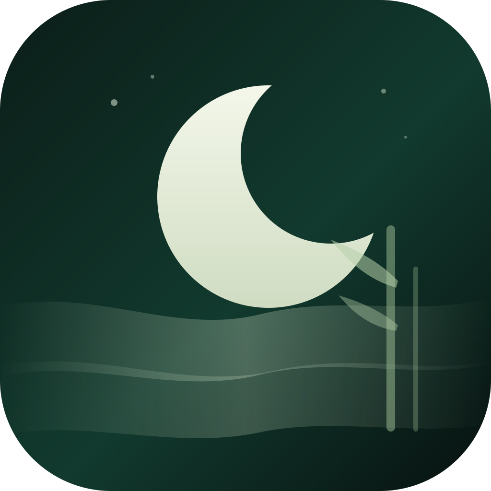
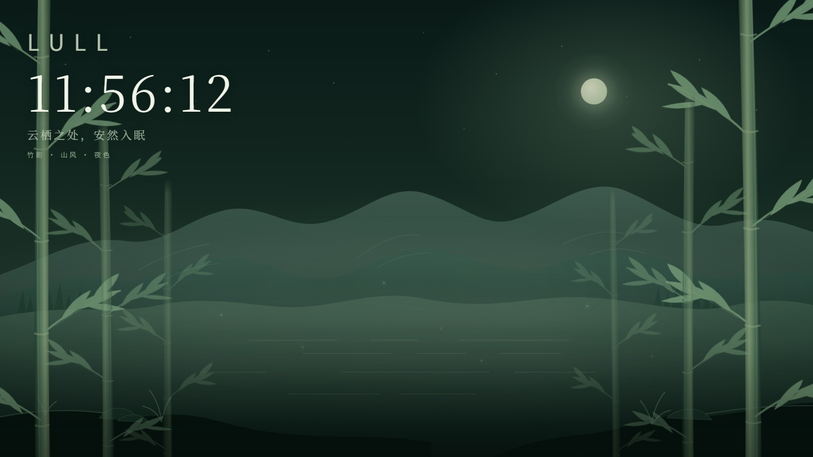

<p align="center">
  
</p>

# 云栖 · Lull

**让 Windows 桌面更宁静：动态壁纸、本地音乐与音境，也为你的创作留出空间。**

[](#安装)
[](https://github.com/Lull-Desktop/Lull/releases/latest)
[](LICENSE)

[English](README.md) · **简体中文**

[下载](https://github.com/Lull-Desktop/Lull/releases/latest) · [官网](https://lull-desktop.github.io/Lull/) · [开发入门（English）](docs/en/getting-started.md) · [参与贡献](#参与贡献)

Lull 是一个开源的 Windows 桌面应用：让动态场景铺在桌面图标下，让浮窗播放器承载本地曲库，让多层音境陪伴工作与休息。它在本地运行，常驻系统托盘，支持简体中文和 English。

对开发者而言，桌面也是创作空间：用 Web 技术制作壁纸、编写工具窗口、替换播放器，或让一个小型游戏世界在多块屏幕上展开。

## 预览



*竹影 1.2.0，使用当前官方场景源码与默认薄雾参数渲染。[预览说明](docs/assets/README.md)。*

## 核心能力

| 能力 | 可以做什么 |
| --- | --- |
| **动态壁纸** | 在桌面图标下显示图片、视频、随包场景和自定义 Web 场景；支持多显示器复制、独立和跨屏模式。 |
| **着色器壁纸** | 粘贴 GLSL 或载入本地 `.glsl` / `.frag` 文件；随包渲染器支持 Shadertoy 风格与普通片元着色器，以及受支持的多 Pass 布局。 |
| **本地音乐** | 浏览歌曲、收藏、歌单与播放队列，在音乐管理窗口维护目录、标签和智能歌单。 |
| **音境混音** | 叠加多条音轨、分别调节音量、设置睡眠定时器，管理本地音境素材与可复用预设。 |
| **桌面工具** | 从托盘打开浮窗工具，将音乐播放器或音境控制器切换为已安装的其他实现；液态番茄钟作为示例扩展另行安装。 |
| **自定义扩展** | 使用 TypeScript SDK 和可运行示例开发场景、工具与实验性桌面游戏；音频响应场景可读取 Lull 音频引擎提供的视觉特征。 |

本地壁纸、音乐、音境素材和已安装扩展无需账号或云同步即可使用。操作方法、扩展安装和排错见[使用指南](docs/guides/user-guide.zh-CN.md)。

## 安装

从 [GitHub Releases](https://github.com/Lull-Desktop/Lull/releases/latest) 下载 Windows x64 安装包或便携版，也可以通过[官网下载页](https://lull-desktop.github.io/Lull/download/)进入。

- **运行要求：** Windows 10 / 11、Windows 桌面外壳和 Microsoft Edge WebView2 Runtime。安装器可以引导安装 WebView2；便携版需要机器上已有该运行时。
- **安装包签名：** 当前安装包尚未签名，Windows 可能显示“未知发布者”提示。
- **首次使用：** 从托盘打开设置，在“壁纸”页选择场景并开启显示壁纸；需要音乐或音境时，从托盘打开对应工具。
- **退出应用：** 关闭设置窗口会将它隐藏；通过托盘菜单“退出”结束 Lull 并卸下壁纸。

本 README 描述当前源码。已发布安装包包含哪些功能，以对应 Release 的说明为准；[package.json](package.json) 中的源码版本可能领先于公开发布版本。

## 为桌面创作

扩展是通过受限宿主桥运行的 Web 包。可以从 HTML、CSS 和 JavaScript 开始，工具示例还包含 React 和 Vue。开发基础工具或场景不需要先构建 Rust 应用。

| 想做什么 | 当前源码中的 SDK | 从这里开始 |
| --- | --- | --- |
| 交互壁纸与音频响应场景 | [`@lull/scene-sdk`](packages/scene-sdk)，**0.4.0** | [参数示例](examples/scenes/param-demo) · [鼠标响应](examples/scenes/pointer-demo) · [音频响应](examples/scenes/audio-demo) · [Scene 指南](docs/scene-sdk.md) |
| 浮窗工具 | [`@lull/widget-sdk`](packages/widget-sdk)，**0.3.1** | [首个工具（English）](docs/en/getting-started.md#build-your-first-widget) · [液态番茄钟](examples/widgets/liquid-pomodoro) · [Widget 指南](docs/widget-sdk.md) |
| 音乐播放器与音境控制器 | [`@lull/media-sdk`](packages/media-sdk)，**0.3.1**，配合 Widget SDK | [Mini Player](examples/widgets/mini-player) · [媒体服务](docs/media-service.md) |
| 桌面游戏 | [`@lull/game-sdk`](packages/game-sdk)，**0.1.0** | [游戏示例](examples/games) · [Game 指南](docs/game-sdk.md) · [`packages/`](packages) 中的 Canvas、Phaser、PixiJS、Three.js 适配器 |

四个 SDK 均处于 **Experimental（实验性）** 阶段，独立演进。请使用与宿主源码版本匹配的 SDK；源码公开不等于承诺跨版本兼容。场景音频响应要求宿主 API 5 和 `wallpaper.audio` 能力，提供的是 Lull 音频的视觉分析数据，不是系统音频采集或播放控制接口。

**推荐入口：**[英文快速入门](docs/en/getting-started.md)覆盖从获取源码到打包首个可安装工具的全过程。仓库也提供可选的 [AI 智能体技能与 CLI](Skill/lull-extension/README.md)，用于生成骨架、校验和打包；使用 CLI 不要求先安装智能体技能。中文操作流程见[开发参考](docs/guides/development.zh-CN.md)。

宿主使用 **Tauri 2、Rust 和 C++ Win32 桌面层**，界面使用 **Next.js / React / TypeScript**。扩展通过 SDK 使用宿主能力，不会获得任意原生命令入口。模块边界见[架构说明](docs/architecture.md)，构建与原生验收见[开发参考](docs/guides/development.zh-CN.md)。

## 从源码运行

在 Windows 上准备 **Node.js 22**、[`package.json`](package.json) 声明的 pnpm、**MSVC 工具链的 Rust**、**Visual Studio C++ 桌面构建工具与 Windows SDK**，以及 **Git Bash**。完整环境与排错步骤见[英文快速入门](docs/en/getting-started.md#run-the-desktop-app)和[中文开发参考](docs/guides/development.zh-CN.md)。

```powershell
git clone https://github.com/Lull-Desktop/Lull.git
cd Lull
pnpm install --frozen-lockfile

# 首次运行，或修改原生宿主之后
& "C:\Program Files\Git\bin\bash.exe" src-tauri/native/build-shim.sh

pnpm dev
```

Debug 构建默认打开设置，不挂载桌面壁纸。使用 `pnpm test-mode` 验证真实桌面挂载，该流程另需安装了 Pillow 的 Python，或 `uv`。`pnpm build` 构建安装包，`pnpm release:package` 整理发布产物。

[官网](website/README.md)是独立项目，有自己的 Node 版本要求；修改站点时请遵循其开发指南。

## 参与贡献

可以从一个场景、一份可复现的问题报告或一段更清楚的说明开始，不必先熟悉原生宿主。

- **反馈问题：** 在 [Issues](https://github.com/Lull-Desktop/Lull/issues) 附上 Lull 版本、Windows 版本、复现步骤和相关日志；壁纸问题还请提供显示器布局与缩放比例。
- **改进文档与翻译：** 保持两份 README 信息一致，帮助更多开发者阅读中文深度文档。
- **贡献扩展：** 基于示例制作并验证场景或工具，提交时附清单、许可和安装步骤。
- **参与应用开发：** 先读[贡献指南](docs/contributing.md)或[英文贡献清单](docs/en/getting-started.md#before-opening-a-pull-request)，提交验证结果，并使用 DCO sign-off（`git commit -s`）。
- **私密报告安全问题：** 遵循 [SECURITY.md](SECURITY.md)，不要在公开 Issue 中披露可利用细节。

## 当前边界

- **仅支持 Windows。** Win32 桌面宿主没有 macOS / Linux 回退实现。
- **扩展接口仍在实验期。** 游戏运行时可用于实验，广泛的引擎组合与 WebView 长时间运行验证仍在推进。
- **本地安装扩展。** 更新会检查版本，失败时尝试恢复旧包；目前没有在线扩展市场或扩展自动更新服务。
- **视频默认使用 HTML 播放。** 可选 `native-media` 后端需要额外 FFmpeg / 原生依赖及兼容的 WebView2 环境，见[媒体运行时](docs/media-runtime.md)。
- **着色器兼容范围有限。** 渲染器接受本地源码，不提供 Shadertoy 在线搜索或下载；外部输入限制见[着色器指南](docs/shadertoy-import.md)。

## 许可与致谢

Lull 对不同部分采用不同许可：

| 范围 | 许可与说明 |
| --- | --- |
| 桌面应用 | [GPL-3.0-or-later](LICENSE) |
| 公开 SDK | Apache-2.0；见 [SDK-LICENSE.md](SDK-LICENSE.md) 与各包的许可声明 |
| 文档及指定的内容 / 示例 | CC BY 4.0；具体范围见 [CONTENT-LICENSE.md](CONTENT-LICENSE.md) 和[许可说明](docs/licensing.md) |
| 第三方扩展、着色器、字体及其他素材 | 保留各自许可，见 [THIRD_PARTY_NOTICES.md](THIRD_PARTY_NOTICES.md) |
| Lull 名称与 Logo | [商标政策](TRADEMARK.md) |

随包官方场景代码与第三方素材不统一归入 CC BY。复用或分发时请保留各自声明；GitHub Release 同时提供对应版本的源码归档。
